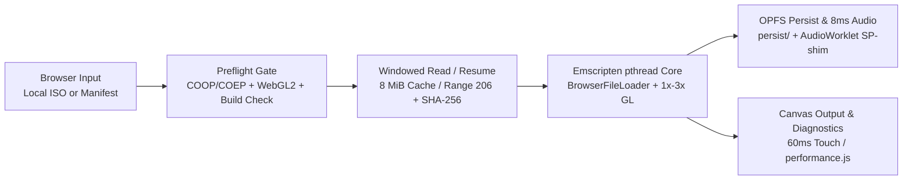

# PPSSPW · WebAssembly PSP Emulator Client

[简体中文](README.md) | **English**

[](LICENSE)
[](https://ppsspw.cbnv.me/en/docs/)

**PPSSPW** (**P**layStation **P**ortable **S**imulator **S**uitable for **P**laying on the **W**eb) is a self-contained browser packaging of upstream `ppsspp-wasm` and `ppsspp-web`. The repository vendors the Angular web shell, minimal core C++ patches, build/verification tooling, and an optional Ad Hoc relay stack while shipping **zero PSP games, BIOS files, or private CDN credentials**.

## Core Capabilities & Data Flow

- **8 MiB Windowed ISO Access**: `BrowserFileLoader` proxies core `ReadAt` calls across an Emscripten pthread boundary into 256 KiB slices capped by an 8 MiB LRU cache, keeping large disc images out of `MEMFS`.
- **OPFS Chunked Resume & ZSTD Streaming**: Remote manifests validate `HTTP 206` byte ranges with per-chunk SHA-256 checksums into OPFS sync handles under Web Locks, paired with `canOwn` sync takeovers and 1 MiB chunked ZSTD savestate reads.
- **Render Scaling, Touch Controls & 8 ms Audio Pump**: Supports `1x`–`3x` internal resolution, multi-touch controls with a `60 ms` tap floor, DPI-first viewport resizing with a `720`-unit responsive UI tab threshold, and an `8 ms` clock-gated `AudioWorklet` (`SP-shim`).
- **Sanitized Telemetry & Release Gates**: Exports sanitized FPS/timing JSON reports (no titles, URLs, or logs); CI preparation scripts reject unflagged `WASM_FRAME_TIMING` / `WASM_IR_BLOCK_PROFILE` diagnostic builds from shipping to production.
- **Optional Self-Hosted Relay Stack**: Preserves a `PRO`/`PU1`/`PT1` WebSocket relay with `open`/`keys` SQLite auth (`LOCAL_ONLY = true` currently hides multiplayer and cloud tabs in the UI).



## Quick Start (Local Packaged Preview)

Prerequisite: compiled WASM core artifacts present locally, plus Node.js 24+, `pnpm`, and Python 3.13+:

```sh
# 1. Build Angular assets and validate/package core into wasm-page/dist/ppsspp-web/
make app-build && python3 scripts/package-player.py

# 2. Launch the COOP/COEP/CORP/CSP local preview server on 127.0.0.1:17881
python3 server/serve-player.py

# Optional: run offline JS runtime/download & Python preview unit suites
pnpm --dir wasm-page test && python3 -m unittest discover -s server/player-tests -v
```

Other deployment and build modes are covered in the documentation site ([ppsspw.cbnv.me/en/docs](https://ppsspw.cbnv.me/en/docs/)):

| Mode / Target | When to Use | Guide |
| --- | --- | --- |
| Docker Compose preview | Expose prebuilt `wasm-page/dist/ppsspp-web` on `0.0.0.0:17881` | [Deployment, Headers & Manifests](docs-site/en/docs/deployment.md#2-docker-compose-static-preview) |
| Full WASM build & EdgeOne CI | Compile from source (`emsdk:6.0.12`) and deploy via GitHub Actions | [Deployment, Headers & Manifests](docs-site/en/docs/deployment.md#3-full-toolchain-build--edgeone-ci-release) |
| Chunked manifest prep (`create-game-manifest.py`) | Split owned ISOs into 64 KiB–16 MiB chunks with SHA-256 verification | [Deployment, Headers & Manifests](docs-site/en/docs/deployment.md#5-creating-chunked-game-manifests--optional-relay-stack) |
| Self-hosted Ad Hoc relay (`deploy/relay/`) | Run the Caddy + Docker Compose `PRO`/`PU1`/`PT1` WebSocket relay | [Contracts & Protocol](docs-site/en/docs/contracts.md#3-ad-hoc-websocket-relay-protocol-local_only--true-ui-gate) |
| Local docs site dev & build | Preview or build `docs-site` separately via `pnpm --dir docs-site` | [Overview & Scope Boundaries](docs-site/en/docs/index.md) |

## Pre-Adoption FAQ

1. **Why are `COOP` and `COEP` headers mandatory?**
   Emscripten `pthreads`, cross-thread `BrowserFileLoader` proxying, and the zero-copy `AudioWorklet` ring require `SharedArrayBuffer`, which browsers unlock only when `crossOriginIsolated === true` inside a secure context (`HTTPS` or `localhost`).

2. **Does loading a 1.5 GB ISO copy the entire disc into RAM?**
   No. Only a zero-byte `MEMFS` stub is mounted while `BrowserFileLoader` streams 256 KiB slices through an 8 MiB LRU window; core WASM memory defaults to `512 MiB` initial / `4 GiB` max.

3. **Are Netplay and cloud save tabs enabled by default?**
   No. `wasm-page/public/ppsspp-runtime.js` sets `LOCAL_ONLY = true`, hiding `tabNetwork` and `tabDrive`. The full `server/relay.py` and `deploy/relay/` stack remain in the repo for self-hosted testing and customization.

4. **What toolchain is needed for a full WASM core rebuild?**
   A Linux or WSL host with `emsdk:6.0.12` (or `scripts/ci/Dockerfile`) running `make pages` or `scripts/ci/build.sh`; UI-only changes only require `make app-build`.

5. **Does PPSSPW bundle games, or does `3x` resolution sharpen 2D sprites?**
   No games, manifest hosts, or credentials are bundled. Higher `InternalResolution` (`1x`–`3x`) scales 3D geometry rendering only and does not upscale low-resolution 2D textures.

## Reading Paths

| Goal | Public Docs (`docs-site/en/`) | Source Walkthroughs (`repo-docs/`, Chinese) |
| --- | --- | --- |
| Deploy static assets, headers & manifests | [Overview, Deployment & FAQ](docs-site/en/docs/index.md) | [Local Run Walkthrough](repo-docs/walkthroughs/one-real-run.md) |
| Integrate 8 MiB reads, Range resume & relay | [Contracts](docs-site/en/docs/contracts.md) | [Windowed ISO Module](repo-docs/modules/windowed-iso-and-download.md) / [Relay Module](repo-docs/modules/adhoc-relay-protocol.md) |
| Tune FPS, 1x–3x scale, audio & memory | [Performance Tuning](docs-site/en/docs/performance.md) | [Runtime & Stability Module](repo-docs/modules/runtime-perf-and-stability.md) |
| Inspect architecture diagram, ADRs & code map | [Architecture & Decisions](docs-site/en/docs/architecture.md) | [Code Map](repo-docs/code-map.md) / [Glossary](repo-docs/glossary.md) / [Source Evidence](repo-docs/references/source-evidence.md) |

## License & Upstream Attribution

- Combined project outputs are licensed under [GNU AGPLv3](LICENSE) (`AGPL-3.0-only`), built upon `GPL-2.0-or-later` upstream PPSSPP sources with original notices and [LICENSE.TXT](LICENSE.TXT) preserved.
- Bundled third-party components (FFmpeg, SDL, glslang, FreeType, zstd, etc.) retain their directory-level licenses and locked commit provenance in [UPSTREAM.md](UPSTREAM.md).
- Icon and brand wordmark assets are documented in [branding/README.md](branding/README.md). Intended strictly for technical evaluation and user-owned backups; commercial or unauthorized distribution is prohibited.
