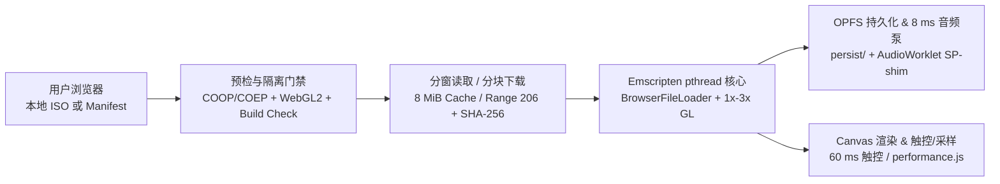

<p align="center">
  
</p>

<h1 align="center">PPSSPW · PSP 网页模拟器</h1>

<p align="center">
  <a href="LICENSE"></a>
  <a href="https://ppsspw.cbnv.me/docs/"></a>
</p>

<p align="center">
  <strong>简体中文</strong> | <a href="README.en.md">English</a>
</p>

<p align="center">
  <a href="https://ppsspw.cbnv.me/docs/">在线文档站</a> · <a href="docs-site/api-reference/index.md">API 与组件参考</a> · <a href="repo-docs/README.md">源码指南</a>
</p>

**PPSSPW**（PlayStation Portable Simulator Suitable for Playing on the Web）是基于上游 `ppsspp-wasm` 与 `ppsspp-web` 独立维护的中文浏览器 PSP 模拟器客户端，参见 [API 与组件参考](docs-site/api-reference/index.md)。仓库内完整保存前端页面、工具脚本、可选中继后端与锁版本核心源码，无需在构建时临时拉取外部上游；同时**不包含任何游戏镜像、下载 CDN 或第三方私有凭据**，玩家需使用自己合法持有的镜像或合规清单。

## 能力边界与明确非目标

- **能做到什么程度**：
  - 浏览器端免整盘载入 `MEMFS` 直接流式运行本地 `.iso`/`.cso`/`.chd` 镜像（`256 KiB` 切片 / `8 MiB` LRU / `4` 并发），并支持 `HTTP 206` + `SHA-256` 校验与 Web Locks 互斥写入 OPFS，搭配 `1 MiB` 流式 ZSTD 即时存档；
  - 提供 `1x–3x` 3D 分辨率、每 `8 ms` 校验的 `SP-shim AudioWorklet`、`60 ms` 防粘连多指触控、脱敏性能导出及配套 `PRO`/`PU1`/`PT1` 中继服务端（全参数详见 [API 与组件参考](docs-site/api-reference/index.md)）。
- **明确不做什么**：
  - **绝不分发 ROM/BIOS 且默认关闭联机/云盘 UI**：前端 `ppsspp-runtime.js:31` 锁定 `LOCAL_ONLY = true` 隐藏 `tabNetwork` 与 `tabDrive`；
  - **不可绕过跨源隔离与 HTTPS 上下文**：缺失 `COOP: same-origin` / `COEP: require-corp` 或移动局域网明文 HTTP 无法解锁 `pthreads` 与 SAB 音频泵；`3x` 仅提升 3D 内部倍率，不超分 2D 贴图；
  - **容器预览不重编 WASM、无公网密钥 HTTP 后台**：`docker-compose.yml` 仅暴露静产物；`relay_admin.py` 仅走本地 CLI；CI 默认拒绝诊断版核心（`WASM_FRAME_TIMING`/`WASM_IR_BLOCK_PROFILE`）上线。

## 核心能力与运行架构

- **8 MiB 分窗读盘与多线程调度**：`BrowserFileLoader` 通过 Emscripten 代理把核心 `ReadAt` 请求切回 JS 层 256 KiB 分块缓存（总上限 8 MiB），避免整包载入 `MEMFS`；仿真循环运行在独立 `pthread` 防止阻塞主线程。
- **OPFS 断点下载与即时存档优化**：支持以 `HTTP 206` 与逐块 `SHA-256` 校验将远程分块清单落盘至 OPFS（Web Locks 互斥），结合 `canOwn` 所有权移交与 1 MiB 流式 ZSTD 解压缩降低读档内存尖峰。
- **画质倍率、多指触控与 8 ms 音频泵**：支持 `1x`–`3x` 渲染内部分辨率、60 ms 最短轻触保底与失焦释放的屏幕手柄、DPI 优先刷新与 `720` 阈值原生设置分栏，以及基于 `SharedArrayBuffer` 与 `70 ms` 前瞻门控的 `AudioWorklet`（`SP-shim`）。
- **脱敏性能采样与发布门禁**：网页可导出不含游戏名、URL 与日志的帧率/耗时 JSON；CI 发布校验脚本默认拦截带 `WASM_FRAME_TIMING` / `WASM_IR_BLOCK_PROFILE` 的诊断核心进入生产站点。
- **可选中继服务栈**：保留可配置 `open`/`keys` SQLite 鉴权的 `PRO`/`PU1`/`PT1` WebSocket 中继栈（当前发行 UI 默认 `LOCAL_ONLY = true` 隐藏联机与云盘入口）。



## 快速开始（本地预览打包）

前提：已按构建说明生成或取得配套 WASM 核心产物，并安装 Node.js 24+、`pnpm` 与 Python 3.13+：

```sh
# 1. 构建网页资源并打包校验核心产物至 wasm-page/dist/ppsspp-web/
make app-build && python3 scripts/package-player.py

# 2. 启动带 COOP/COEP/CORP/CSP 响应头的本地受限预览服务（127.0.0.1:17881）
python3 server/serve-player.py

# 可选：离线回归网页运行时合约与预览服务端口独占约束
pnpm --dir wasm-page test && python3 -m unittest discover -s server/player-tests -v
```

其他构建与部署方式请直接查看文档站（[ppsspw.cbnv.me/docs](https://ppsspw.cbnv.me/docs/)）：

| 使用或部署模式 | 适用场景 | 入口文档 |
| --- | --- | --- |
| Docker Compose 静态预览 | 在 `0.0.0.0:17881` 快速暴露已构建好的 `wasm-page/dist/ppsspp-web` | [部署模式与下载清单准备](docs-site/docs/deployment.md#模式二docker-compose-静态预览容器) |
| 全量 WASM 工具链编译 & EdgeOne CI | 使用 `emsdk:6.0.12` 完整编译核心并通过 GitHub Actions 发布 | [部署模式与下载清单准备](docs-site/docs/deployment.md#模式三全量工具链构建与-edgeone-pages-ci-发布) |
| 分块下载清单制作（`create-game-manifest.py`） | 为自持镜像切分 64 KiB–16 MiB 分块并配置 `HTTPS` + `Range 206` | [部署模式与下载清单准备](docs-site/docs/deployment.md#准备在线分块下载清单game-manifest) |
| 自托管 Ad Hoc 中继（`deploy/relay/`） | 使用 Caddy + Docker Compose 启动带 SQLite 密钥管理的联机中继 | [部署模式与下载清单准备](docs-site/docs/deployment.md#可选部署-ad-hoc-多人中继服务) |
| 本地文档站预览与静态构建 | 启动 `docs-site` VitePress 开发预览或输出静态文档站点 | [概览与运行边界](docs-site/docs/index.md) |

## 采用前常见疑问

1. **为什么必须在服务端配置 `COOP` / `COEP` 响应头？**
   PPSSPW 的多线程仿真（`pthreads`）、`BrowserFileLoader` 跨线程代理和低拷贝 `AudioWorklet` 都需要 `SharedArrayBuffer`，浏览器仅在 `crossOriginIsolated === true` 且安全上下文（`HTTPS` 或 `localhost`）下放行。

2. **载入 1.5 GB 的 PSP 镜像会撑爆浏览器内存吗？**
   不会整盘载入内存。前端仅挂载零字节 `MEMFS` 存根并用 8 MiB LRU 窗口按需读取 `256 KiB` 切片，核心初始线性内存为 `512 MiB`、上限 `4 GiB`。

3. **克隆仓库启动后可以直接联机或同步云端存档吗？**
   默认发行版前端在 `ppsspp-runtime.js` 设置了 `LOCAL_ONLY = true`，隐藏了联机（`tabNetwork`）和云驱动（`tabDrive`）面板；仓库保留了完整的 `server/relay.py` 与 `deploy/relay/` 实现供自托管测试与二次集成。

4. **从源码重新编译 WASM 核心需要什么环境？**
   需要 Linux 或 WSL 环境搭配 `emsdk:6.0.12`（或直接使用 `scripts/ci/Dockerfile` 工具链镜像）执行 `make pages` 或 `scripts/ci/build.sh`；只改前端壳层可直接运行 `make app-build`。

5. **客户端是否附带游戏 ROM，调高 `3x` 分辨率能增强 2D 贴图吗？**
   不附带任何游戏文件、清单地址或账号凭据；调高 `InternalResolution` 仅提升 3D 几何渲染倍率，不会替低分辨率原图或 2D HUD 自动超分细节。

## 阅读路径导航

| 读者目标 | 公开文档站（`docs-site/`） | 源码维护指南（`repo-docs/`） |
| --- | --- | --- |
| 初次部署、清单生成与响应头排错 | [概览、部署与排错 FAQ](docs-site/docs/index.md) | [本地运行主流程](repo-docs/walkthroughs/one-real-run.md) |
| 集成 8 MiB 读盘、Range 续传或中继协议 | [分窗、续传与中继契约](docs-site/docs/contracts.md) · [API 与组件参考](docs-site/api-reference/index.md) | [分窗与下载模块](repo-docs/modules/windowed-iso-and-download.md) / [中继模块](repo-docs/modules/adhoc-relay-protocol.md) |
| 调优高负载帧率、音频与稳定性边界 | [画质倍率、音频与稳定性调优](docs-site/docs/performance.md) | [运行时节拍与性能模块](repo-docs/modules/runtime-perf-and-stability.md) |
| 浏览交互架构图、变更决策与源码定位 | [架构图谱与工程决策](docs-site/docs/architecture.md) | [代码地图](repo-docs/code-map.md) / [术语表](repo-docs/glossary.md) / [源码证据](repo-docs/references/source-evidence.md) |

## 许可与上游致谢

- 本项目组合程序依据 [GNU AGPLv3](LICENSE)（`AGPL-3.0-only`）条款发布，同时完整保留上游 `ppsspp-wasm` 核心、`ppsspp-web` 兼容层以及 [LICENSE.TXT](LICENSE.TXT) 中的原作者版权与 `GPL-2.0-or-later` 许可声明。
- 第三方组件（FFmpeg、SDL、glslang、FreeType、zstd 等）各自沿用所在目录原有许可证与源码声明，详细锁定提交清单与合规边界见 [上游来源与第三方声明](UPSTREAM.md)。
- 网页图标与字标资源归口见 [品牌资源说明](branding/README.md)；本项目仅供技术学习与个人持有合法游戏镜像运行测试使用，严禁用于商业或未授权分发。

- **附加条款与资产规则**：本项目依据 GNU AGPLv3 第 7 条适用 [`LICENSE-ADDITIONAL_TERMS-zh-CN.md`](LICENSE-ADDITIONAL_TERMS-zh-CN.md)（英文参考译文：[`LICENSE-ADDITIONAL_TERMS-en.md`](LICENSE-ADDITIONAL_TERMS-en.md)，以简体中文完整版正文为准），对来源陈述、修改标识、禁止冒充、扩展模块有条件附加许可及项目标识边界作出补充说明；工程落地参考见 [`IMPLEMENTATION-GUIDE.zh-en.md`](IMPLEMENTATION-GUIDE.zh-en.md)，人员署名、AI 辅助工具、上游/第三方代码及独立美术字体与标识资产综合清单见 [`ASSETS_LICENSES.md`](ASSETS_LICENSES.md)。附加要求与第 9.5–9.6 款附加许可豁免均分别核实相应版权持有人有效授权，未取得该等授权的第三方或上游材料仍受其原有有效许可约束。
